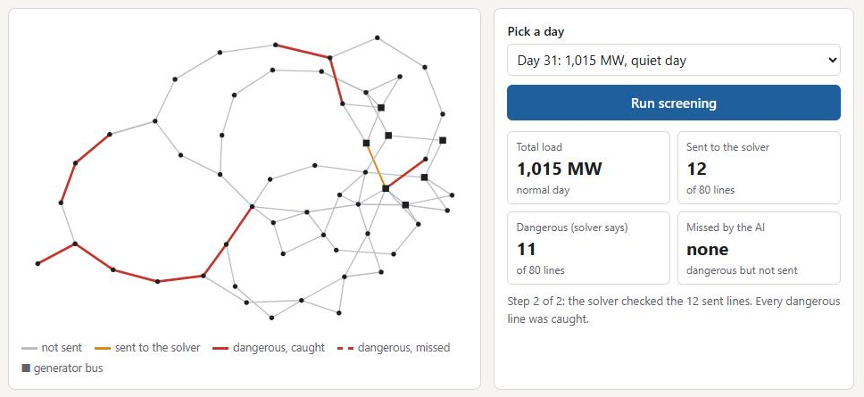

# If one power line fails, does anything overload?

**An AI checks all 80 possible line failures on a power grid in 0.15 s. A real
power flow solver then confirms only the risky ones. The AI sorts, the solver
decides.**

[](https://hamza-atiq.github.io/p013-grid-contingency-screening/)

**Try it:**

- **[Live page](https://hamza-atiq.github.io/p013-grid-contingency-screening/)**: opens instantly. Pick a day, press Run. Recorded results from the real model and solver.
- **[Run it live in Colab](https://colab.research.google.com/github/Hamza-Atiq/p013-grid-contingency-screening/blob/main/notebooks/p013_live.ipynb)**: the real model and solver on a new day. Press Run all, about a minute.
- **[Full results](https://hamza-atiq.github.io/p013-grid-contingency-screening/results.html)**: all 50 tests one by one, and every case the AI missed.

## The result in one look

Tested on 8,750 unseen days (50 random tests of 175 days each):

| What | Result |
| --- | --- |
| **Dangerous cases caught** | **99.91% or more** in every one of the 50 tests |
| **Speed** | **2.25x faster** than solving all 80 cases (typical test); about **5x** on a normal-load day |
| **Days where a dangerous case slipped through** | **14 of 8,750**, about 1 day in 625 (and those 14 are only 4 different days) |
| **Tests** | 330 automated tests, passing on a fresh download |

## Why this matters

Grid operators must always know: *if any one line or transformer trips right
now, will another line overload, or will some voltage fall too low?* This check
is called **N-1 contingency analysis** ("N minus one": the grid with one part
missing).

The exact way is to solve the full AC power flow again for every possible
failure. On this grid that is 80 solves for every snapshot of the grid. When
conditions change quickly, that is slow.

A common idea is to replace the solver with a fast AI model. But a model that
is wrong about even one dangerous case is not safe to trust. So here the AI is
only allowed to **sort**. It ranks the 80 cases by danger, and the real solver
checks every case that could be dangerous. The solver always has the final word.

## Why I built it

I am an electrical engineering graduate. During my degree I spent a month at
Tarbela power station and a week inside a grid station with a double busbar
and bus coupler. I watched operators take a bus out of service while the load
moved across to the other bus. This project asks the same question, "what
happens if this part goes out?", and tries to answer it fast enough to ask it
about every part, all the time.

## How it works

1. **The grid.** The IEEE 57-bus test grid (57 nodes, 80 lines and
   transformers), from the PGLib-OPF library. With pandapower I generated
   20,000 training snapshots, plus 750 separate days of load and generation
   for testing.
2. **The AI.** A graph neural network: it treats the grid as a graph and passes
   messages along the lines, written by hand in PyTorch. Each line has an
   on/off flag, and a line that is off carries no message, so one trained model
   covers all 80 failures. It predicts the voltage at every bus, and line flows
   are computed from those voltages.
3. **A danger score.** A case is dangerous if any line carries more than 100%
   of its rating, or any bus voltage ends up more than 0.05 per unit further
   outside the 0.95 to 1.05 range than it was before the failure. (Five buses
   already sit slightly outside that range with nothing wrong, so the voltage
   check counts how much worse a failure makes things.) The same check runs on
   the AI's predicted voltages and flows, and gives each of the 80 cases a
   danger score.
4. **The screening rule.** On heavy-load days, all 80 cases go to the solver.
   On normal days, every case whose score is at or above a learned cutoff goes
   to the solver. Both the heavy-day line and the cutoff are learned only from
   "practice" days and graded on unseen "exam" days.
5. **Safety checks in code.** If a failure would split the grid apart
   (islanding), the AI is never asked; the case always goes to the solver. The 7
   cases that could not be solved on any practice day (L37, L40, L41, L42, L44,
   T05, T06) also always go to the solver. I checked that this rule sends
   exactly the same cases as the recorded run on all 50 tests, so the numbers
   above hold for a screen that could really run live.
6. **The solver decides.** pandapower's Newton-Raphson AC power flow solves
   every case that was sent. Its answer is the one that counts.

## Honest results and limits

| What | Result |
| --- | --- |
| Speed vs. solving all 80 cases | 2.25x faster (median over the 50 tests) |
| Cases sent to the solver | 32.7 of 80 per day on average (median test) |
| Days with at least one missed dangerous case | 14 of 8,750, about 1 day in 625 |
| Worst share of dangerous cases caught, in any test | 99.91% |
| Tests with zero misses | 39 of 50 |

**I set a pass mark in advance, and it was not reached.** I wanted zero misses
on at least 48 of 50 tests and got 39. With the selection rule exactly as I
first wrote it down (which picked a different screening rule), it was 31 of 50.
So this tool cannot promise that it never misses. What it can state is the
measured miss rate above.

Limits:

- **Heavy days gain nothing.** About 3 in 10 days are heavy, and on those all
  80 cases go to the solver, so they are slightly slower than solving directly.
  The speed comes from normal days.
- One grid (IEEE 57-bus), all synthetic days. Not tested on a bigger grid or on
  real operating data.
- Only line and transformer failures. Generator, load and busbar failures are
  out of scope.
- The misses happen on normal-load days, where the cutoff is learned from a
  limited number of practice days. Every miss is a voltage drop the model
  predicts too small on a few specific lines. That is what I would study next.
- The 50 tests are reshuffles of the same 750 days, so they overlap. The 14
  miss days are only 4 different days, each counted once for every test it was
  missed in.
- Timings come from one dual-core laptop with no GPU: one AC solve takes about
  0.051 s, so all 80 take about 4.1 s. The AI's average voltage error is about
  0.0076 per unit (under 1% of normal voltage).

## Prior work

The model is not new, and I do not claim it is. What I built is the pipeline
around it: the exact grid-splitting check, the solver-has-the-final-word setup,
and an honest measurement of how often it misses.

- PowerFlowNet: *Power Flow Approximation Using Message Passing Graph Neural
  Networks*, arXiv:2311.03415. The closest model to mine.
- *Graph Neural Networks for Fast Contingency Analysis of Power Systems*,
  arXiv:2310.04213. GNN contingency screening, also tested on IEEE 57 and 118.
- DeepOPF: X. Pan, T. Zhao, M. Chen, S. Zhang, *DeepOPF: A Deep Neural Network
  Approach for Security-Constrained DC Optimal Power Flow*, IEEE Transactions
  on Power Systems, arXiv:1910.14448. A dense network for a related problem
  (OPF, not screening).
- pandapower: L. Thurner et al., *pandapower: An Open-Source Python Tool for
  Convenient Modeling, Analysis, and Optimization of Electric Power Systems*,
  IEEE Transactions on Power Systems, doi:10.1109/TPWRS.2018.2829021. Used for
  every power flow solve in this project.
- The grid data is `pglib_opf_case57_ieee.m` from the IEEE PES Power Grid
  Library (PGLib-OPF, v23.07), vendored unmodified in `cases/` under its
  CC BY 4.0 license.

## How to run it yourself

Needs Python 3.11. Use a virtual environment.

```
python -m venv .venv
.venv\Scripts\activate          (Windows; on Linux/macOS: source .venv/bin/activate)
pip install -r requirements.txt --extra-index-url https://download.pytorch.org/whl/cpu
pip install -e .
```

**Get the data** (about 270 MB, not in the repo: 121 MB of generated power
flow data and 146 MB of saved model predictions). It is on Hugging Face at
[ABDHAM/p013-grid-contingency-screening-data](https://huggingface.co/datasets/ABDHAM/p013-grid-contingency-screening-data).
From the repository root:

```
hf download ABDHAM/p013-grid-contingency-screening-data --repo-type dataset --include "data/*" --include "eval/*" --local-dir .
```

This puts `data/` and `eval/cache/` exactly where the code expects them. (`hf`
comes with `pip install huggingface_hub`.) The dataset card on Hugging Face
lists the SHA-256 of every file.

**Run the tests** (from the repository root):

```
pytest
```

With the data downloaded, all tests run. Without it, the tests that need the
full generated data or the prediction cache skip themselves. `data_smoke/` is
a small (about 1 MB) dataset kept in the repo for the unit tests.

**Or regenerate the data from scratch** instead of downloading it. Fixed
seeds, so it comes out the same. Each step is slow on a laptop; run them one
at a time.

```
python -m p013.generate
python -m p013.generate --only sweep --test-points 500 --seed 20260916 --out data/practice
```

The first command writes `data/train.npz` (20,000 samples) and
`data/test_sweep.npz` (250 days). The second writes the 500 extra practice
days. Then rebuild the prediction caches and the robustness test:

```
python experiments/build_cache.py
python experiments/build_cache.py --sweep data/practice/test_sweep.npz --split practice --out eval/cache/practice_predictions.npz
python experiments/round2_robustness.py --pool eval/cache/predictions.npz eval/cache/practice_predictions.npz --out experiments/results/round2_rerun.json
```

The trained weights are already in `model/`, so you do not need to retrain.
(`python -m p013.train --out model_new` retrains from `data/train.npz` if you
want to; without `--out` it overwrites `model/`.)

**Open the site:** double-click `site/index.html` (the same page as the live
link at the top). Pick any of the 175 exam days, or one of the 4 days the
screen ever missed, and press Run. `site/results.html` is the full results
page: the 50 tests one by one and every missed case. To rebuild both (needs
the data):

```
python site/make_site.py
python demo/make_demo.py
```

Both refit the policy on all 50 tests and stop with an error unless every
test matches `experiments/results/round2_main_original.json`, and both rerun
the trained model on days they show.

**Run the live app locally:** `pip install gradio==6.29.1`, then
`python space/app.py`. It uses `model/live_policy.npz`, the screening policy
frozen by `python experiments/build_live_policy.py`, which refuses to write
unless the fit equals the recorded one. `tests/test_live_parity.py` checks
that the app gives the recorded model outputs, scores and decisions.
`notebooks/p013_live.ipynb` is the same app for Google Colab.

## Author

**Hamza Atiq**, electrical engineering graduate, applying for graduate study
in power systems and machine learning.
GitHub: [Hamza-Atiq](https://github.com/Hamza-Atiq) · Email: hamzaatiq34@gmail.com

## License

MIT, see `LICENSE`. The vendored case file in `cases/` keeps its own CC BY 4.0
license.
